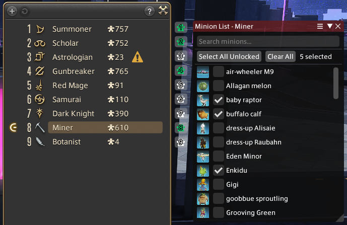

## LoyalCompanion
Associates minion lists with gearsets and auto-summons a random minion from the list when conditions allow.

**Author:** Le Vagabond



## Features
- Configure a list of minions for each gearset
- Automatically summons a random minion from the list when you equip a gearset
- Overlay buttons on the Gear Set List window for quick configuration
- Searchable minion picker with icons
- Respects game state: won't summon while mounted, in combat, in duties, etc.

## Installation
- Open the Dalamud Plugin Installer
- Go to Settings
- Head to the "Experimental" tab
- Under "Custom Plugin Repositories", paste this URL and click the `+` button:

  ```
  https://raw.githubusercontent.com/Le-Vagabond-gh/FFXIV_Dalamud_Repo/main/repo.json
  ```

- Press "Save and Close"
- Install "LoyalCompanion" from the main plugin installer window

Updates then arrive through the plugin installer like for any other plugin.

If you would rather control updates yourself, download `LoyalCompanion-<version>-full.zip` from [Releases](https://github.com/Le-Vagabond-gh/ffxiv_loyalcompanion/releases) (releases are immutable, so a published build can never be swapped), extract it and add the extracted `LoyalCompanion.dll` as a dev plugin location under the same "Experimental" tab.

## Usage
1. Open the Gear Set List in-game
2. Click the paw icon next to any gearset to configure its minion list
3. Check the minions you want associated with that gearset
4. When you equip the gearset, a random minion from the list will be summoned automatically
